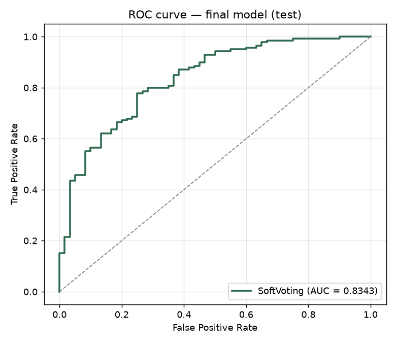
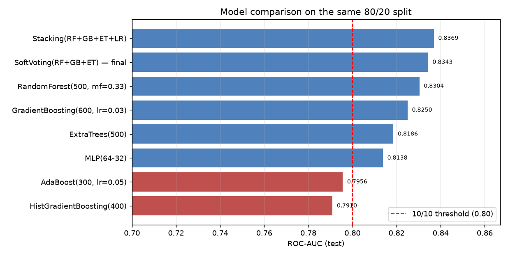
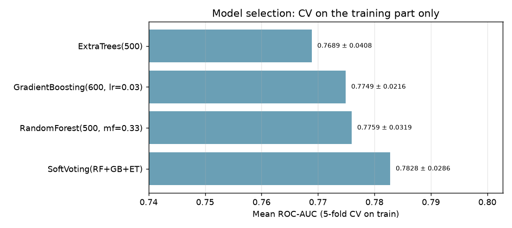

# Отчёт по лабораторной работе №4. Ансамбли и полносвязные нейронные сети

## Данные и подготовка

- Датасет `german.csv`: **1000 строк × 21 столбец**, разделитель `;`.
- Целевая переменная — первый столбец `Creditability`:
  **1 (хороший кредит) — 700**, **0 (плохой) — 300** (дисбаланс 70/30).
- Остальные **20 признаков** уже представлены в числовом (порядковом) виде,
  поэтому дополнительное кодирование не требуется.
- Пропусков нет, полных дублей строк нет, константных столбцов нет.
- Разбиение: стратифицированное **80/20**, `random_state=42`:
  train — **800** объектов (560 класса 1 и 240 класса 0),
  test — **200** объектов (140 класса 1 и 60 класса 0).
- Деревья и их ансамбли не требуют масштабирования, поэтому признаки
  подаются в исходном виде. Для MLP-кандидата `StandardScaler` встроен в
  `Pipeline` и обучается только на train-части.
- **Протокол без утечки:** отбор модели и гиперпараметров делался по
  5-fold CV ROC-AUC **только на train**; `test_target` использовался
  исключительно для финального расчёта метрик. Тестовая часть «трогалась»
  один раз — после выбора модели.

## Гипотезы и эксперименты

### Гипотезы

1. **Bagging снижает разброс.** На выборке всего 1000 объектов Random Forest
   и Extra Trees должны быть устойчивее одиночных деревьев.
2. **Bagging + boosting дают разную ошибку.** Random Forest уменьшает
   дисперсию, Gradient Boosting — смещение, поэтому их объединение должно
   дать положительный эффект.
3. **Soft voting лучше базовых моделей.** Усреднение вероятностей разнородных
   ансамблей должно повысить ROC-AUC по сравнению с каждой моделью отдельно.
4. **Stacking может дать ещё немного AUC,** но за счёт времени и, возможно,
   более низких accuracy/F1 при пороге 0.5.
5. **HistGradientBoosting и AdaBoost на малой выборке слабее** классических
   RF/GB из-за регуляризации и слабых базовых деревьев.
6. **MLP требует масштабирования** и на 800 объектах менее стабилен, чем
   ансамбли деревьев.

### Конфигурации

| Модель | Основные параметры |
|---|---|
| Random Forest | 500 деревьев, `max_features=0.33`, `min_samples_leaf=1` |
| Gradient Boosting | 600 деревьев, `learning_rate=0.03`, `max_depth=3`, `subsample=0.8` |
| Extra Trees | 500 деревьев, `max_features='sqrt'` |
| Soft Voting (финал) | RF + GB + ET, `voting='soft'`, равные веса |
| Stacking | RF + GB + ET + LogisticRegression, мета-модель — логистическая регрессия, `cv=5` |
| HistGradientBoosting | `max_iter=400`, `learning_rate=0.05`, `l2_regularization=1.0` |
| AdaBoost | 300 оценщиков, `learning_rate=0.05` |
| MLP | `hidden_layer_sizes=(64, 32)`, `alpha=1e-3`, `early_stopping=True` + `StandardScaler` |

### Отбор модели: 5-fold CV ROC-AUC только на train

| Модель | Mean ROC-AUC | Std |
|---|---|---|
| **SoftVoting (RF+GB+ET)** | **0.7828** | 0.0286 |
| RandomForest (500, mf=0.33) | 0.7759 | 0.0319 |
| GradientBoosting (600, lr=0.03) | 0.7749 | 0.0216 |
| ExtraTrees (500) | 0.7689 | 0.0408 |

Критерий выбора — максимум среднего CV ROC-AUC на train; при близких
значениях — accuracy/F1 и время обучения. Победил **Soft Voting**.

### Сравнение кандидатов на одном test (для отчёта)

Все модели обучались на одном и том же train (800 объектов), test не
использовался для настройки.

| Модель | ROC-AUC | Accuracy | Precision | Recall | F1 | Время, с |
|---|---|---|---|---|---|---|
| Stacking (RF+GB+ET+LR) | 0.8369 | 0.7900 | 0.8182 | 0.9000 | 0.8571 | 20.4 |
| **SoftVoting (RF+GB+ET) — финал** | **0.8343** | **0.8000** | **0.8205** | **0.9143** | **0.8649** | **4.0** |
| RandomForest (500, mf=0.33) | 0.8304 | 0.8200 | 0.8291 | 0.9357 | 0.8792 | 1.4 |
| GradientBoosting (600, lr=0.03) | 0.8250 | 0.8000 | 0.8333 | 0.8929 | 0.8621 | 1.4 |
| ExtraTrees (500) | 0.8186 | 0.7950 | 0.8153 | 0.9143 | 0.8620 | 1.0 |
| MLP (64-32) | 0.8138 | 0.7600 | 0.7911 | 0.8929 | 0.8389 | 0.2 |
| AdaBoost (300, lr=0.05) | 0.7956 | 0.7100 | 0.7158 | 0.9714 | 0.8242 | 0.9 |
| HistGradientBoosting (400) | 0.7910 | 0.7700 | 0.8133 | 0.8714 | 0.8414 | 3.2 |

## Метрики

### Финальная модель — Soft Voting (RF + GB + ET)

| Метрика | Значение |
|---|---|
| **ROC-AUC** | **0.8343** |
| Accuracy | 0.8000 |
| Precision | 0.8205 |
| Recall | 0.9143 |
| F1 | 0.8649 |

Матрица ошибок на test (200 объектов):

|  | pred = 0 | pred = 1 |
|---|---|---|
| **true = 0** | TN = 32 | FP = 28 |
| **true = 1** | FN = 12 | TP = 128 |

Модель предсказала класс 1 для 156 из 200 объектов. При дисбалансе 70/30 и
пороге 0.5 это даёт высокий recall (0.9143) при умеренной precision
(0.8205): модель реже пропускает «хорошие» кредиты, но допускает 28
ложноположительных срабатываний.







## Выбранная модель

Выбрана **Soft Voting** из трёх ансамблей:

- Random Forest (500 деревьев, `max_features=0.33`);
- Gradient Boosting (600 деревьев, `learning_rate=0.03`, `max_depth=3`,
  `subsample=0.8`);
- Extra Trees (500 деревьев, `max_features='sqrt'`).

Почему именно она:

1. **Лучший честный CV ROC-AUC на train — 0.7828** против 0.7759 у RF,
   0.7749 у GB и 0.7689 у ET. Модель выбрана до просмотра test.
2. **ROC-AUC на test — 0.8343**, то есть уверенно выше порога 0.80.
3. **Баланс метрик лучше, чем у Stacking:** accuracy 0.8000 против 0.7900,
   F1 0.8649 против 0.8571; AUC отличается всего на 0.0026, что лежит в
   пределах разброса одного split.
4. **Время обучения — 4.0 с** против 20.4 с у Stacking, что важно для
   воспроизводимого запуска на CPU.
5. **Разнородность базовых моделей:** bagging (RF, ET) и boosting (GB)
   ошибаются по-разному, поэтому мягкое голосование снижает дисперсию.

Функция возвращает `model_name = "SoftVoting(RandomForest + GradientBoosting + ExtraTrees)"`,
вероятности положительного класса, бинарные предсказания (порог 0.5) и пять
метрик на test.

## Выводы и ограничения

### Что улучшило результат

- **Ансамблирование дало прирост:** Soft Voting (0.8343) выше лучшей одиночной
  модели RF (0.8304), GB (0.8250) и ET (0.8186).
- **Soft voting улучшил и CV:** 0.7828 против 0.7759 у лучшего базового RF.
- **Разные типы ансамблей дополняют друг друга:** bagging-модели и boosting
  дают разные ошибки, их усреднение стабилизирует вероятности.
- **Стратификация** сохранила пропорции классов в test (140/60), что важно
  при дисбалансе 70/30.

### Что не улучшило или ухудшило результат

- **HistGradientBoosting (0.7910)** и **AdaBoost (0.7956)** оказались слабее:
  на 800 обучающих объектах встроенная регуляризация HGB и очень простые
  базовые деревья AdaBoost не успевают использовать структуру данных.
- **MLP (0.8138)** уступил ансамблям деревьев и менее стабилен: на малой
  выборке нейросеть чувствительна к инициализации и режиму early stopping.
- **Stacking** дал максимальный test AUC (0.8369), но проиграл по accuracy/F1
  и оказался в 5 раз медленнее; выигрыш по AUC в пределах шума.

### Ограничения

- Один split 80/20: test содержит всего 200 объектов, поэтому метрики имеют
  заметный разброс. Средний CV AUC (0.7828) ниже test AUC (0.8343) — это
  следствие удачного конкретного split, а не гарантия качества на новых данных.
- Порог классификации фиксирован 0.5 и не оптимизировался; ROC-AUC от порога
  не зависит, но accuracy/precision/recall/F1 можно улучшить подбором порога
  по CV.
- Калибровка вероятностей не проводилась.
- Для Stacking не использовалась вложенная кросс-валидация, поэтому его
  test-оценка может быть оптимистичной.
- Датасет маленький (1000 строк, 20 признаков); выводы стоит перепроверить на
  repeated CV и нескольких random seed.

## Воспроизводимость

- Окружение: **Python 3.14.5**, scikit-learn 1.9.0, numpy 2.5.1,
  pandas 3.0.3, scipy 1.18.0, matplotlib 3.11.1.
- Запуск из корня `lab4`:
  ```
  python run_experiments.py
  ```
- Фиксированы: `random_seed = 42`, `test_size = 0.2`, стратификация,
  5-fold `StratifiedKFold(shuffle=True, random_state=42)`.
- Все модели получают `random_state=data.random_seed` (в контрактной функции —
  `data.random_seed`, по умолчанию 42), поэтому запуск детерминирован.
- `run_experiments.py` печатает таблицы CV и test, сохраняет
  `experiment_results.json` и графики `figures/roc_curve.png`,
  `figures/model_comparison.png`, `figures/cv_auc.png`.
- `experiment_results.json` содержит имя финальной модели, финальные метрики,
  результаты CV на train и сравнительную таблицу на test.
- Контракты из `grader_contracts/` не изменялись.
- Проверено: `test_target` не влияет на вероятности (при перемешивании
  test-меток предсказания не меняются), а функции корректно работают с
  numpy-массивами, `DataFrame`/`Series` и уже масштабированными признаками.
